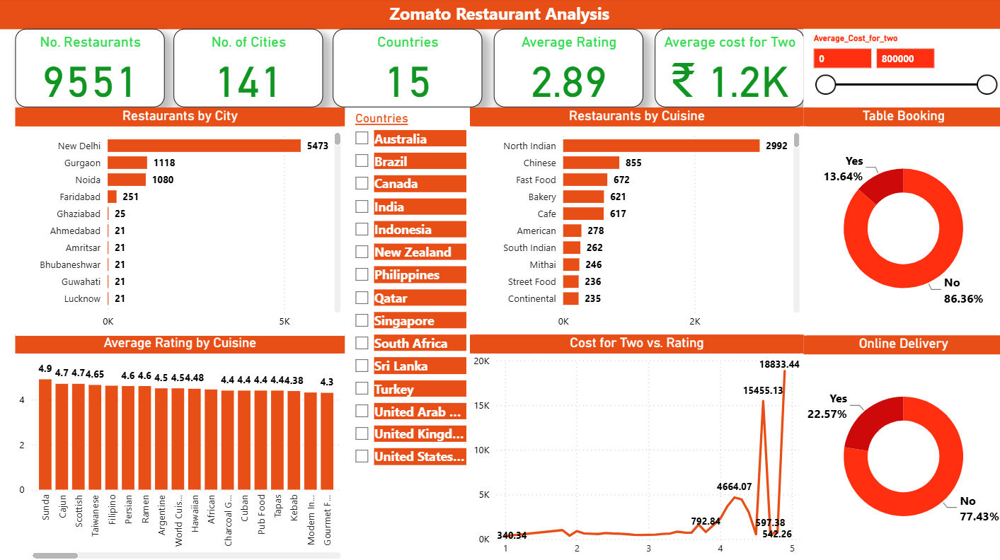

# 🍽️ Zomato Data Analysis Dashboard – Power BI

## 📊 Project Overview
Developed an interactive Power BI dashboard to analyse Zomato restaurant data, providing insights into restaurant distribution, ratings, cuisines, pricing, and customer service options.

## 🎯 Key Objectives
- Analyse restaurant distribution by country and city.
- Evaluate cuisine popularity and average ratings.
- Compare restaurant pricing and cost patterns.
- Analyse table booking and online delivery availability.
- Identify trends to support data-driven insights.

## 🛠️ Tools & Technologies
- Microsoft Power BI
- Power Query
- DAX
- Data Cleaning & Transformation
- Data Modeling and Visualization

## 📈 Dashboard Features
- KPI cards for restaurants, cities, countries, ratings, and average cost for two.
- City-wise and cuisine-wise restaurant analysis.
- Table booking and online delivery analysis.
- Cost and rating comparisons.
- Interactive filters, slicers, and charts.

## 🔄 Data Preparation & Analysis
Used Power Query for data cleaning and transformation, and DAX measures to calculate key metrics and support interactive analysis.

## 🎯 Key Skills Demonstrated
Power BI Dashboard Development | DAX | Power Query | Data Analysis | Data Visualization | Business Intelligence

### Zomato Restaurant Analysis Dashboard

---

## ⭐ Project

This project was created as part of my **Data Analytics portfolio** to demonstrate practical Power BI and business intelligence skills.
